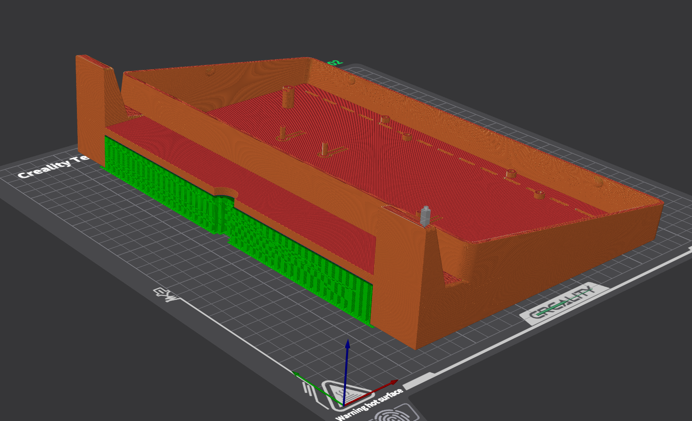
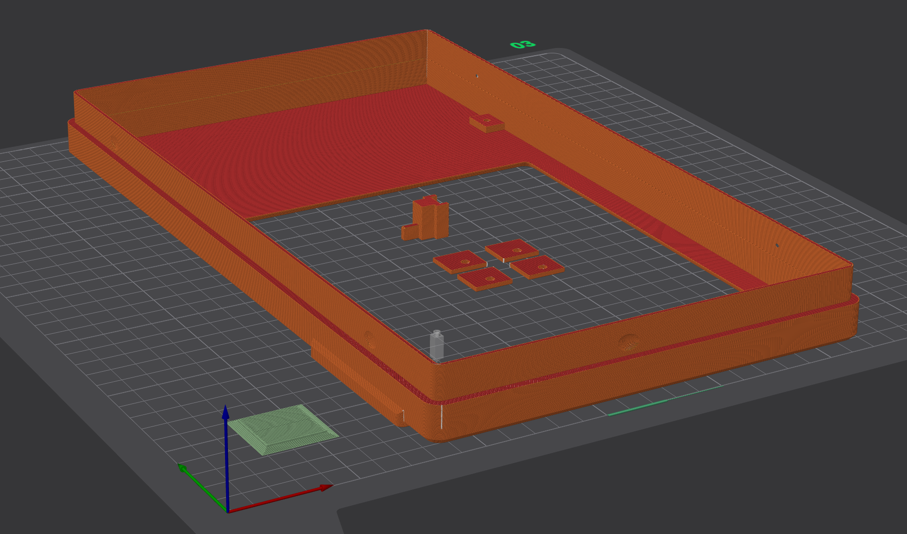

# Printing Notes

## Recommended settings

| Setting | Value |
|---|---|
| Wall thickness | ~2.4mm (2 perimeters at 0.4mm nozzle, or adjust to match) |
| Infill | 15–20% |
| Layer height | 0.2mm for all parts, except the two logo plates (`Lisa_Mini_Lisa_Logo_Plate.obj`, `Lisa_Mini_Manufacturer_Blank_Logo_Plate.obj`) — 0.12mm with ironing enabled, for surface quality |
| Supports | Front only; the back prints without supports (see below) |
| Bed size required | 350mm — the model is 330mm wide |

## Orientation

File locations: shared parts are in `models/print-ready/common/`; the rest
are in the folder for your chosen design (`Lisa_Mini_With_ESFloppy_Screen_And_Buttons_On_Back/` or
`Lisa_Mini_With_ESFloppy_Screen_And_Buttons_On_Front/`).

- `Lisa_Mini_Front.obj` (Design A) — print face
  down
- `Lisa_Mini_Back_LisaFPGA.obj` — print face up
- `Lisa_Mini_LCD_Mount_Clips.obj`, `Lisa_Mini_Lisa_Logo_Plate.obj`,
  `Lisa_Mini_Manufacturer_Blank_Logo_Plate.obj`, `Lisa_Mini_Power_Switch.obj`
  — small parts, orientation is straightforward from their shape
- `Lisa_Mini_ESFloppy_Shroud.obj` (Design A only) — no supports needed; recommended in
  black filament since it's visible on the back of the case

Slicer plating for both shells:

The front shell plates together with the LCD mount clips and power switch,
using the open bed space inside the screen cutout.

## Bed size / smaller printers

The model is 330mm wide, so front/back shells need a 350mm print bed to
print in one piece as designed. If your printer's bed is smaller, you can
slice the front/back shells in half and print in two pieces — but the seam
where the halves join will be visible on the finished part. There's
currently no version of this design pre-split for smaller beds.

## Supports

Only the front shell needs supports:

- **Back** — no supports. The skirt between the legs, which used to be the
  cause, is now a separate part that you print on its own and glue on after
  printing. This saves hours of print time and a lot of support filament.
  Print one of the two skirt variants for your design (see
  [Skirt](#skirt)).
- **Front** (`Lisa_Mini_Front.obj`) —
  needed under the logo plate badge holder area. A PETG support interface
  layer was used there to improve surface quality, though it matters less
  than usual since a logo plate gets inserted into that area anyway,
  covering it.

## Skirt

The back shell's front skirt is its own part. **Print one** skirt for your
design, then glue it to the back shell after printing (see the assembly
guide):

| Variant | Use it if |
|---|---|
| `Choose_One_Lisa_Mini_Skirt_With_Cable_Cutout.obj` (in either design's folder) | You want a cable passthrough |
| `Choose_One_Lisa_Mini_Skirt_No_Cable_Cutout.obj` (in either design's folder) | You use wireless accessories and want it solid |

Print the LCD mount clips (`Lisa_Mini_LCD_Mount_Clips.obj`) and the power
switch (`Lisa_Mini_Power_Switch.obj`) on the same plate as the front
shell — the screen cutout leaves plenty of bed space for these small
parts.

## Material

Printed in [Polar Filament Retro Platinum PLA](https://polarfilament.com/products/retro-platinum-pla-1kg-1-75mm)
— a metallic silver/platinum finish designed for a classic-computing look.
No warping issues on the large front/back shells with this filament.
